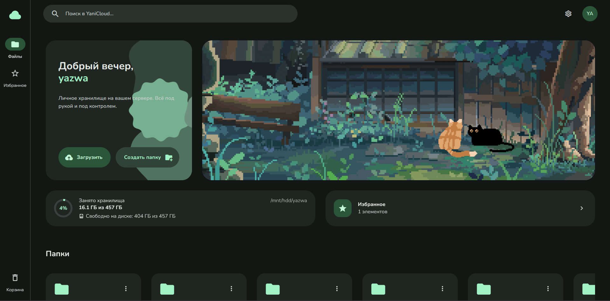
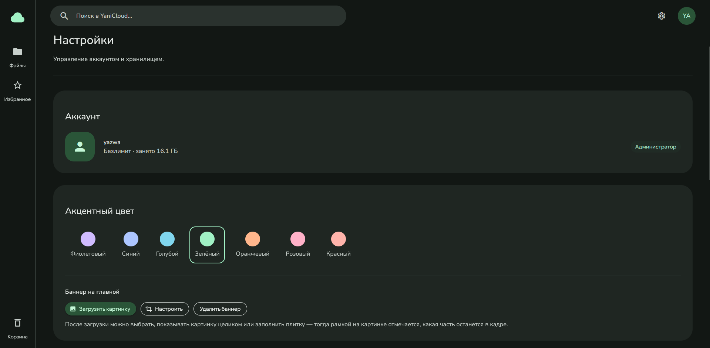
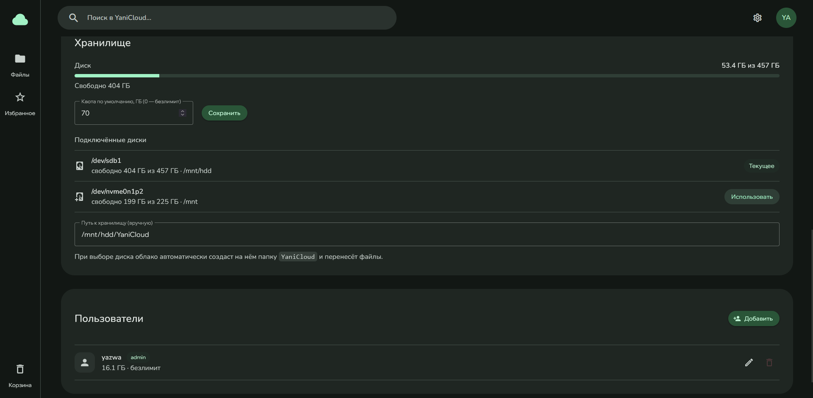
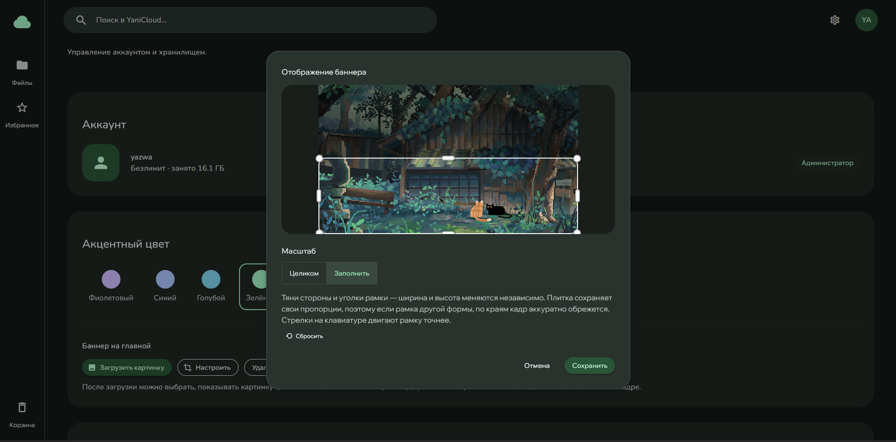
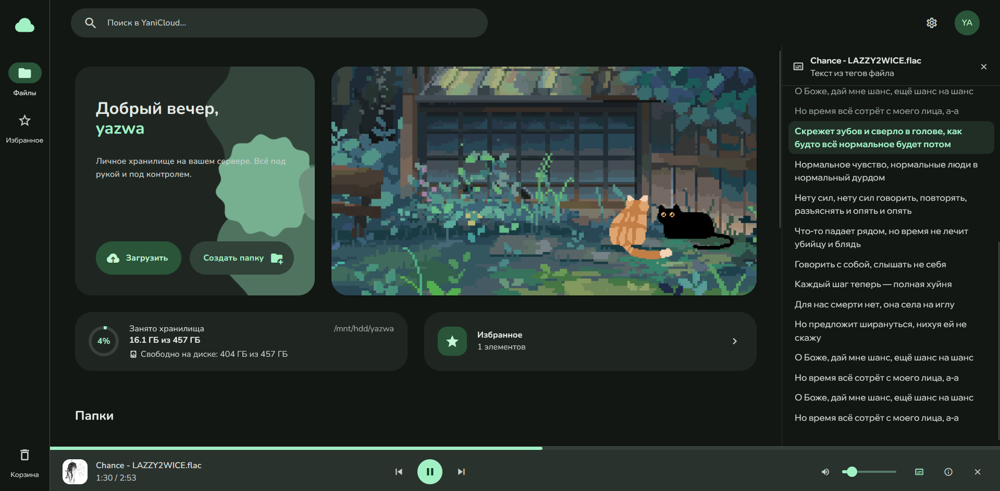

# YaniCloud

[](https://github.com/y4zwa/yanicloud/actions/workflows/ci.yml)

Селфхостед хранилище файлов для домашнего сервера. Файлы лежат у вас, доступ — через веб-интерфейс.

Стек: Vue 3 + Vuetify (фронтенд), Fastify + SQLite (бэкенд), сборка в один Docker-образ.

Проект рассчитан на локальную сеть: публичных ссылок на файлы, синхронизации и доступа из интернета «из коробки» нет.

## Запуск

Нужен Docker с плагином Compose (`docker compose`).

```bash
docker compose up -d --build
```

Откройте `http://<адрес-сервера>:8080` и зарегистрируйте аккаунт. Первый зарегистрированный пользователь автоматически становится администратором. После этого публичная регистрация закрыта: новых пользователей создаёт администратор в настройках (или включите `REGISTRATION_ENABLED=true` в `compose.yaml`).

## Состав

- `compose.yaml` — сервис, порт `8080`, данные в каталоге `./data` (персистентный volume)
- `Dockerfile` — многостадийная сборка фронтенда и бэкенда (в образ включены LibreOffice для предпросмотра офисных документов и ffmpeg для обложек видео)

## Возможности

- Файлы и папки: загрузка (drag-and-drop), скачивание, переименование, удаление
- Полноэкранный просмотр фото: зум колесом/пинчем, панорама, поворот, листание стрелками и свайпом
- Подробности файла (из меню или прямо из плеера, без запуска воспроизведения): EXIF (камера, объектив, выдержка, диафрагма, ISO, GPS), теги аудио, параметры видео, все служебные теги
- Обложка трека: клик по обложке в плеере открывает окно с обложкой; зум колесом/пинчем, панорама, двойной клик — сброс
- Текст песни: правая колонка (как в Spotify), не перекрывает файлы; `.lrc` рядом с треком, текст из тегов или LRCLIB; подсветка текущей строки по таймкоду (и слов, если в тегах word-level разметка), клик по строке — перемотка, автоскролл
- Предпросмотр: фото, видео, музыка (встроенный плеер с громкостью и перемоткой), PDF, офисные документы (через LibreOffice), текст/код
- Избранное, корзина с автоочисткой через 30 дней, поиск
- Закрепление файлов/папок на левую панель (drag-and-drop)
- Мультиюзер, квота на пользователя, админ-панель (управление пользователями, хранилищем и дисками)
- Акцентный цвет и баннер на главной

## Скриншоты

<p align="center">
  
</p>

| Настройки — профиль и оформление | Настройки — хранилище и пользователи |
| --- | --- |
|  |  |

| Обрезка баннера на главной | Текст песни в плеере |
| --- | --- |
|  |  |

## Настройка

Переменные окружения (задаются в `compose.yaml`):

| Переменная | Описание | По умолчанию |
| --- | --- | --- |
| `PORT` | Порт | `8080` |
| `DATA_DIR` | Каталог данных внутри контейнера | `/data` |
| `DEFAULT_QUOTA_BYTES` | Квота по умолчанию для новых пользователей (0 — безлимит) | `75161927680` (70 ГБ) |
| `TRASH_RETENTION_DAYS` | Срок хранения корзины, дней | `30` |
| `REGISTRATION_ENABLED` | Разрешить регистрацию новых пользователей после первого админа | `false` |
| `TRUST_PROXY` | Доверять `X-Forwarded-For` (включать за реверс-прокси, иначе rate limit считает всех одним IP) | `false` |
| `CORS_ORIGIN` | Разрешённый origin, если фронт открывают не с того же адреса | пусто |
| `LYRICS_ONLINE` | Искать тексты песен в LRCLIB (наружу уходят артист и название трека). `false` — только теги файла и `.lrc` рядом | `true` |

## Хранилище на отдельном диске

Смонтируйте диск на хосте (например, в `/mnt/hdd`) — он появится в Настройки → Хранилище → «Подключённые диски». Кнопка «Использовать» создаст на диске папку `YaniCloud` и перенесёт туда файлы (перенос, не копирование).

Если диск отключён или не смонтирован, YaniCloud отвечает `503 Хранилище недоступно`. Новые файлы не пишутся на системный диск, а окончательное удаление, автоочистка корзины и удаление пользователя ничего не стирают, пока диск не вернётся. Каталоги внешних дисков сервис сам не создаёт: они создаются один раз при настройке (создание пользователя с личным каталогом, перенос хранилища).

Диск, смонтированный на хосте уже после запуска контейнера, внутри контейнера не появится: `/mnt` и `/media` пробрасываются без распространения монтирований. После подключения диска перезапустите контейнер: `docker compose restart`.

Перенос прерывается безопасно: файл сначала копируется под временным именем, сверяется и только потом встаёт на место. Если процесс всё же оборвался (упал, кончилось место), при следующем запуске перенос докручивается автоматически — остаток помечен в `data/migrations/root-move.json`.

Если каталог хранилища пропал навсегда (не «диск отключён», а удалён), а записи в базе надо убрать, у администратора есть явное аварийное удаление: `DELETE /api/admin/users/:id?force=1` и `DELETE /api/files/:id/permanent?force=1`. Файлы в этом случае остаются на диске сиротами — включать, только когда данных всё равно уже нет.

## Безопасность

- Пароли хешируются scrypt (соль + тайминг-безопасное сравнение); при неверном логине работа всё равно выполняется, поэтому по времени ответа нельзя определить, есть ли такой пользователь
- Аутентификация по JWT; секрет генерируется случайно при первом запуске и хранится в `data/.jwt-secret`
- Сессии отзываются: токен несёт версию пароля (`users.token_version`), смена пароля и удаление пользователя выкидывают все его старые токены, даже если они ещё не истекли
- Медиа-токены привязаны к файлу и к своему действию: токен миниатюры не открывает `download` или `stream`
- SPA отдаётся с `Content-Security-Policy`, `X-Frame-Options: SAMEORIGIN`, `Referrer-Policy` и `nosniff`
- Файлы хранятся по случайным ключам (UUID), пути к файлам не зависят от имён пользователя
- SQL — только параметризованные запросы; встроенные конвертеры вызываются без shell, у ffmpeg ограничен список протоколов (`-protocol_whitelist file`)

## Разработка

Нужны Node.js 22 и npm. Каждая часть ставится отдельно:

```bash
cd backend           && npm ci
cd frontend/yanicloud && npm ci
```

Запуск: бэкенд на `8080`, фронтенд на `3000` (Vite проксирует `/api` на бэкенд):

```bash
cd backend            && npm run dev
cd frontend/yanicloud && npm run dev
```

Проверки — то же, что гоняет CI:

```bash
cd backend            && npm run typecheck && npm run lint && npm test
cd frontend/yanicloud && npm run type-check && npm run lint
```

Форматирование (Prettier) — из корня репозитория: `npm ci && npm run format`. Конфиг в `.prettierrc.json`; `.vue` исключены, разметку шаблонов правим руками.

## Резервное копирование

Не копируйте `./data` на живой базе: SQLite работает в WAL-режиме, и обычное копирование может дать неконсистентный файл. Используйте `scripts/backup.sh` — он делает консистентный снимок базы (SQLite backup API) и рядом кладёт манифест `id → пользователь → имя → storage_key`:

```bash
BACKUP_DIR=/mnt/hdd/backup/yanicloud ./scripts/backup.sh
```

Файлы пользователей лежат в каталогах из манифеста (`user_dir`, `storage_key`). Сам архив — это база + файлы, поэтому дополнительно синхронизируйте эти каталоги, например:

```bash
rsync -a /mnt/hdd/YaniCloud/ /mnt/hdd/backup/yanicloud-files/
```

Скрипт можно повесить на cron. Без базы имена файлов потеряются (на диске только UUID), поэтому манифест так же важен, как и сама база.

## Лицензия

Проект распространяется под [GNU Affero General Public License v3.0](LICENSE) (AGPL-3.0-or-later), © 2026 y4zwa.

Версии до `v1.0.0` были опубликованы под MIT. Лицензия на уже опубликованные версии не отзывается: их можно использовать на условиях MIT. Начиная с `v1.0.0` действует AGPL-3.0.

Если вы предоставляете изменённую версию YaniCloud как сетевой сервис, AGPL требует предоставить пользователям исходный код этой версии.
