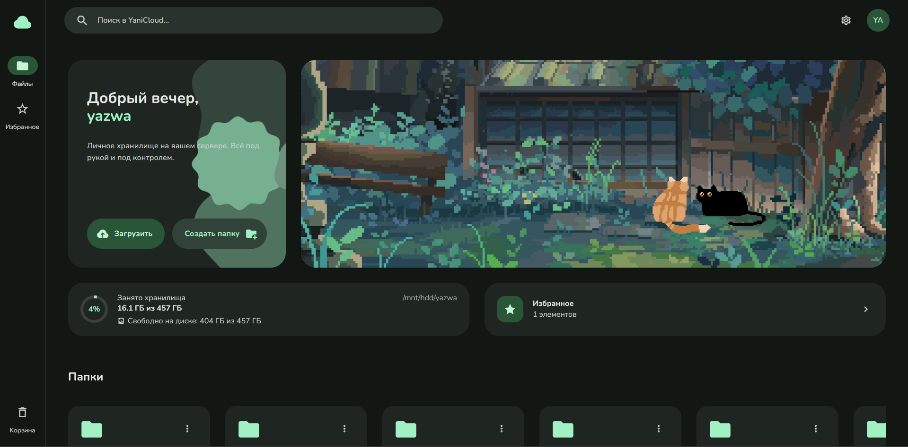
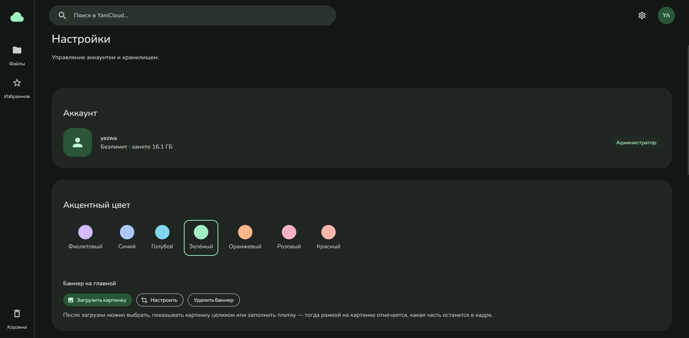
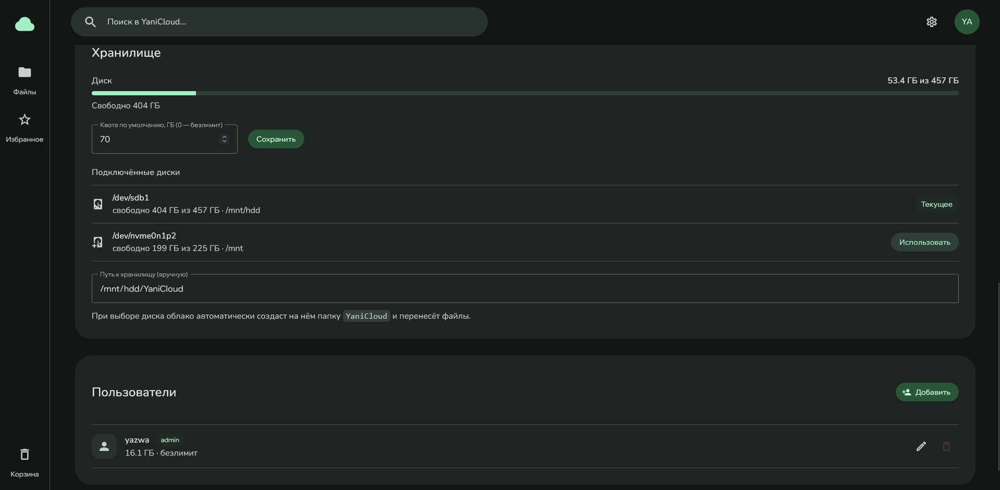

# YaniCloud

Селфхостед облако. Хранит файлы на вашем сервере, отдаёт через веб-интерфейс.

Стек: Vue 3 + Vuetify (фронтенд), Fastify + SQLite (бэкенд), сборка в один Docker-образ.

## Запуск

Нужен Docker с плагином Compose (`docker compose`).

```bash
docker compose up -d --build
```

Откройте `http://<адрес-сервера>:8080` и зарегистрируйте аккаунт. Первый зарегистрированный пользователь автоматически становится администратором. После этого публичная регистрация закрыта: новых пользователей создаёт администратор в настройках (или включите `REGISTRATION_ENABLED=true` в `compose.yaml`).

## Состав

- `compose.yaml` — сервис, порт `8080`, данные в каталоге `./data` (персистентный volume)
- `Dockerfile` — многостадийная сборка фронтенда и бэкенда (в образ включены LibreOffice для предпросмотра офисных документов и ffmpeg для обложек видео)

## Возможности

- Файлы и папки: загрузка (drag-and-drop), скачивание, переименование, удаление
- Полноэкранный просмотр фото: зум колесом/пинчем, панорама, поворот, листание стрелками и свайпом
- Подробности файла (из меню или прямо из плеера, без запуска воспроизведения): EXIF (камера, объектив, выдержка, диафрагма, ISO, GPS), теги аудио, параметры видео, все служебные теги
- Обложка трека: клик по обложке в плеере открывает окно с обложкой; зум колесом/пинчем, панорама, двойной клик — сброс
- Текст песни: правая колонка (как в Spotify), не перекрывает файлы; `.lrc` рядом с треком, текст из тегов или LRCLIB; подсветка текущей строки по таймкоду (и слов, если в тегах word-level разметка), клик по строке — перемотка, автоскролл
- Предпросмотр: фото, видео, музыка (встроенный плеер с громкостью и перемоткой), PDF, офисные документы (через LibreOffice), текст/код
- Избранное, корзина с автоочисткой через 30 дней, поиск
- Закрепление файлов/папок на левую панель (drag-and-drop)
- Мультиюзер, квота на пользователя, админ-панель (управление пользователями, хранилищем и дисками)
- Акцентный цвет и баннер на главной

## Скриншоты

<p align="center">
  
</p>

| Настройки — профиль и оформление | Настройки — хранилище и пользователи |
| --- | --- |
|  |  |

## Настройка

Переменные окружения (задаются в `compose.yaml`):

| Переменная | Описание | По умолчанию |
| --- | --- | --- |
| `PORT` | Порт | `8080` |
| `DATA_DIR` | Каталог данных внутри контейнера | `/data` |
| `DEFAULT_QUOTA_BYTES` | Квота по умолчанию для новых пользователей (0 — безлимит) | `75161927680` (70 ГБ) |
| `TRASH_RETENTION_DAYS` | Срок хранения корзины, дней | `30` |

## Хранилище на отдельном диске

Смонтируйте диск на хосте (например, в `/mnt/hdd`) — он появится в Настройки → Хранилище → «Подключённые диски». Кнопка «Использовать» создаст на диске папку `YaniCloud` и перенесёт туда файлы (перенос, не копирование).

## Безопасность

- Пароли хешируются scrypt (соль + тайминг-безопасное сравнение)
- Аутентификация по JWT; секрет генерируется случайно при первом запуске и хранится в `data/.jwt-secret`
- Файлы хранятся по случайным ключам (UUID), пути к файлам не зависят от имён пользователя
- SQL — только параметризованные запросы; встроенные конвертеры вызываются без shell

## Резервное копирование

Все данные — в каталоге `./data` (SQLite-база + файлы). Для бэкапа достаточно скопировать этот каталог.

## Лицензия

Проект распространяется под [GNU Affero General Public License v3.0](LICENSE) (AGPL-3.0-or-later), © 2026 y4zwa.

Версии до `v1.0.0` были опубликованы под MIT. Лицензия на уже опубликованные версии не отзывается: их можно использовать на условиях MIT. Начиная с `v1.0.0` действует AGPL-3.0.

Если вы предоставляете изменённую версию YaniCloud как сетевой сервис, AGPL требует предоставить пользователям исходный код этой версии.
